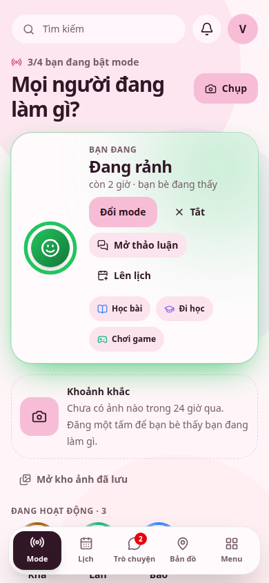
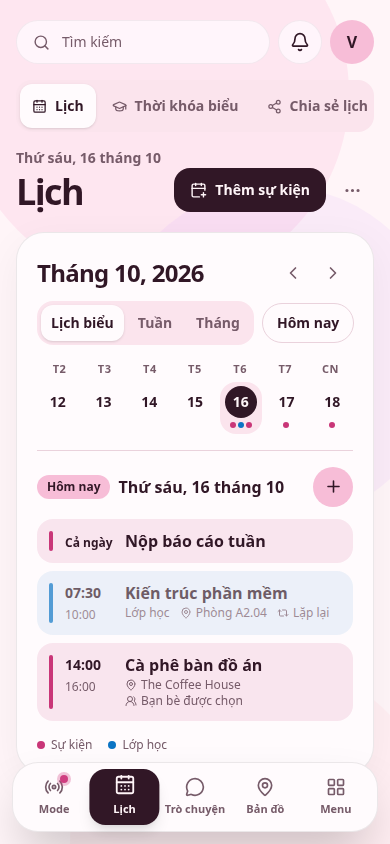
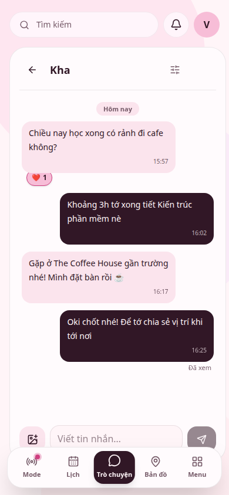
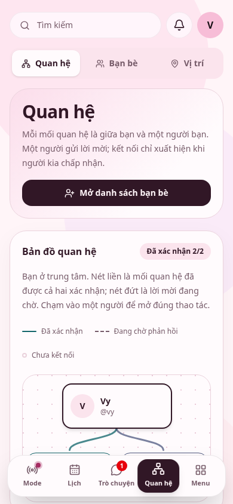
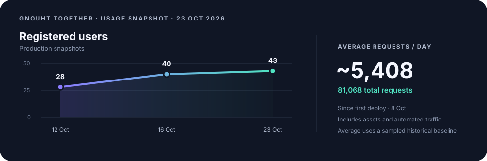

<div align="center">


# Gnouht Together

Plan your day and stay close to the friends you choose.

[Open app](https://9try.gnouht.space) · [Install](#install) · [Guides](#guides)

</div>

## Screens

<table>
<tr><th>Mode</th><th>Calendar</th><th>Chat</th><th>Relationships</th></tr>
<tr><td></td><td></td><td></td><td></td></tr>
</table>

## Usage snapshot



*23 Oct 2026 UTC. Request average is approximate and includes static files and automated traffic.*

## Features

Modes, moments, chat, calendar, friend connections, shared location, habits, notes and privacy controls for small groups.

## Run locally

Requires Node.js 22.12 or newer.

```sh
cp .env.example .env.local
npm ci
npm run dev
```

Add the Supabase URL and publishable key to `.env.local`. `VITE_*` values are public; never put server secrets there.

**Stack:** React · TypeScript · Vite · Supabase · MapLibre

## Guides

[Architecture](docs/architecture.md) · [Module guide](docs/module-guide.md) · [Deployment](docs/deployment.md) · [Permissions](docs/permission-matrix.md) · [Backup](docs/backup-restore.md)

## Install

On Android, use **Install app** in Chrome. On iPhone or iPad, use **Share → Add to Home Screen** in Safari.

Never run `supabase db reset --linked` or database tests against production. Map styles derive from [OpenFreeMap Positron](docs/architecture.md#the-map); attribution and licenses are listed there.
