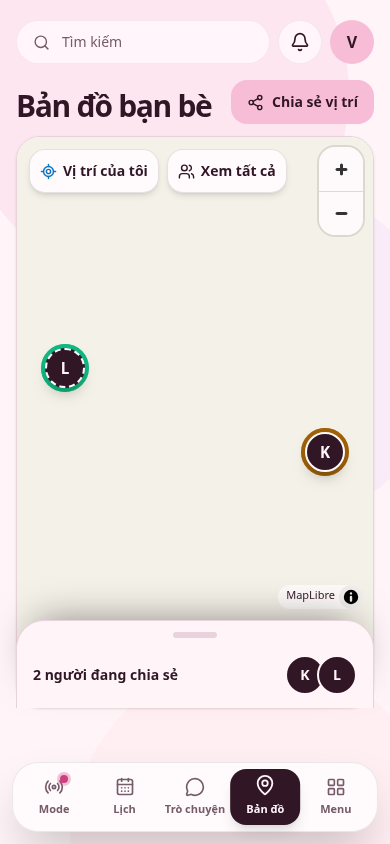
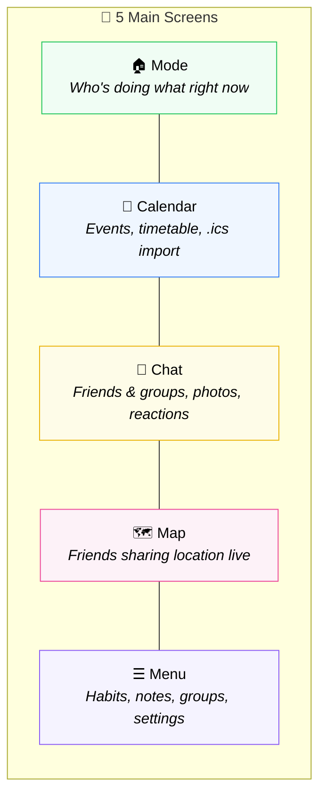
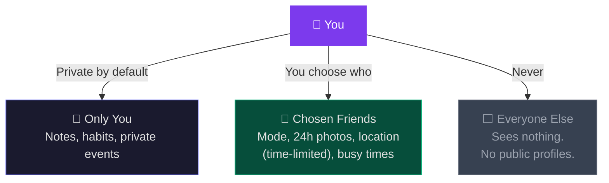
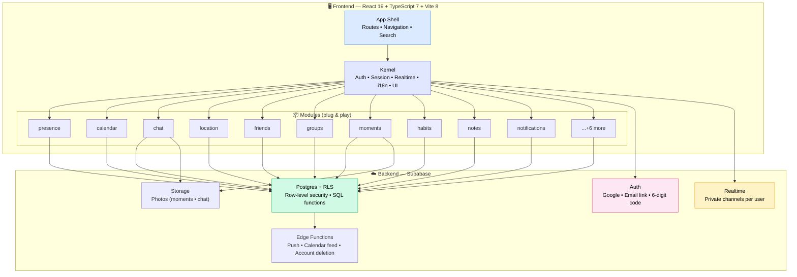
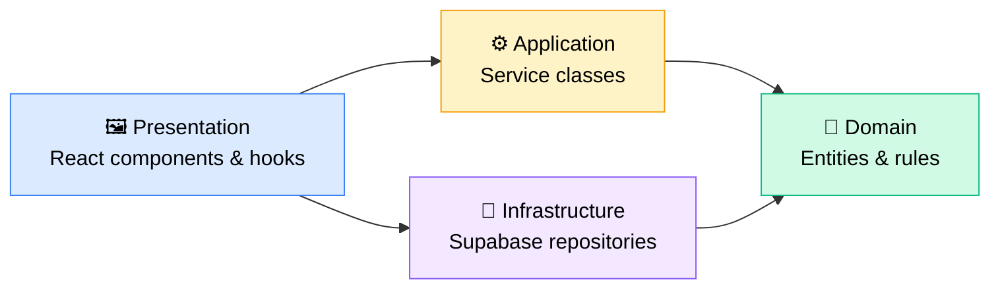

<div align="center">

<!-- Replace with your actual app icon -->


# Gnouht Together

### See what your friends are up to. Meet up in a few taps.

A Vietnamese-first social planning & personal organizer for trusted friends and classmates.

[](https://9try.gnouht.space)
[](#install)
[](#tech-stack)

</div>

---

## 📸 App Preview

<!-- 
  🖼️ SCREENSHOT GUIDE — Replace these placeholders with real screenshots!
  
  Recommended shots (16:9 or phone aspect ratio):
  1. hero.png     — Mode screen showing friends' activities  
  2. calendar.png — Calendar week/month view with events
  3. chat.png     — Chat conversation with reactions & photos
  4. map.png      — Map with friend markers and mode rings
  5. moments.png  — Photo of the day on Mode screen
  
  How to capture:
  - Open https://9try.gnouht.space on Chrome
  - Use DevTools → Toggle Device Toolbar (Ctrl+Shift+M) → iPhone 14 Pro
  - Take screenshots with Ctrl+Shift+P → "Capture screenshot"
  - Save to docs/screenshots/ folder
  - For dark mode shots, toggle in app settings
-->

<div align="center">

| Mode (Home) | Calendar | Chat | Map |
|:-:|:-:|:-:|:-:|
|  |  |  |  |
| *See who's free, studying, or grabbing coffee* | *Your schedule, timetable & shared events* | *Rich messaging with replies & reactions* | *Find friends sharing their location* |

</div>

---

## 🎬 How It Works — A Day with Gnouht

<div align="center">

```
  ┌─────────────┐         ┌─────────────┐         ┌─────────────┐
  │  ☕ Set your │         │  👀 Friends  │         │  📍 Meet up  │
  │    Mode     │────▶    │   see you   │────▶    │   IRL!      │
  │             │         │             │         │             │
  │ "Coffee" /  │         │ They reply, │         │ Share your  │
  │ "Studying"/ │         │ check your  │         │ location    │
  │ "Free"      │         │ calendar    │         │ for a set   │
  └─────────────┘         └─────────────┘         │ time        │
                                                  └─────────────┘
```

</div>

> **Less "are you free?" texts. More actually meeting up.** ✨

---

## 📊 Live Usage

<!-- 
  📈 Live metrics automatically updated from Supabase & Cloudflare
  Last verified: 2026-10-16
-->

<div align="center">

| 👤 Registered Users | 👁️ Page Views | 🌐 Total Requests |
|:---:|:---:|:---:|
| **`40`** | **`755+`** | **`≈ 62.5k`** |
| *active profiles* | *landing visits* | *all app host requests* |

> [!NOTE]
> These metrics are **live** on the [landing page](https://9try.gnouht.space) — refreshed automatically from Supabase RPC & Cloudflare Durable Objects.

</div>

### Daily Engagement

<!-- Replace placeholder values (—) with real numbers from your database -->

<div align="center">

| Metric | Value | Trend |
|:---|:---:|:---:|
| 💬 **Messages sent** (last 30d) | `—` | — |
| 📅 **Calendar events** created | `—` | — |
| 🟢 **Weekly active mode users** | `—` | — |
| 📸 **Moments shared** (last 7d) | `—` | — |
| 🗺️ **Location shares** (last 7d) | `—` | — |
| 👥 **Active conversations** | `—` | — |
| ✅ **Habit check-ins** (last 7d) | `—` | — |

</div>

---

## ✨ Features at a Glance

<div align="center">



</div>

| Feature | What it does |
|:---|:---|
| **🟢 Mode** | One tap to show "Coffee ☕", "Studying 📚", or "Free 🟢". Friends who matter most appear on top with reasons. |
| **📸 Moments** | Photo of the day — visible for 24h to chosen friends, then gone. |
| **📅 Calendar** | Week list, month view, hour grid. Import `.ics` timetables. Share busy times with chosen friends. Private iCal feed. |
| **💬 Chat** | 1:1 and group. Replies, reactions, edit (15min), unsend. "Seen" status. Photo cards. Search. Mute. |
| **🗺️ Live Map** | Friends as face markers with mode rings. Time-limited sharing, you choose who sees you. Latest position only. |
| **👥 Friends & Groups** | Requests, invite links, block. Groups with roles, link expiry, archive. |
| **✅ Habits** | Daily/weekly tracking with streaks. |
| **📝 Notes** | Personal notes. |
| **🔔 Notifications** | In-app center + Web Push. Quiet hours. Per-category control. |
| **🔒 Privacy Screen** | See what others can see about you right now. One-tap stop for each. |
| **🌐 Bilingual** | Vietnamese & English. Switch anytime. |
| **📲 PWA** | Install on home screen. Works offline (app shell). No app store needed. |

---

## 🔒 Privacy by Design

<div align="center">



</div>

> **Your location is only sent while you're actively sharing, to people you pick, and the server only keeps your latest position.** No tracking. No history.

---

## 🏗️ Architecture Overview

<div align="center">



</div>

### Module Architecture (Clean Architecture)



> **Adding a feature = one new folder in `src/modules/` + one line in `src/app/modules.ts`.** Nothing else needs editing.

---

## <a name="install"></a> 📲 Install

<table>
<tr>
<td width="50%" align="center">

### Android / Chrome

Open menu → **"Install app"** or **"Add to Home screen"**

</td>
<td width="50%" align="center">

### iPhone / iPad (Safari)

**Share** → **"Add to Home Screen"**

*Push notifications require this step on iOS.*

</td>
</tr>
</table>

---

## <a name="tech-stack"></a> 🛠️ Tech Stack

<div align="center">

| Layer | Technology |
|:---|:---|
| **Frontend** | React 19 · TypeScript 7 · Vite 8 · Tailwind 4 · TanStack Query |
| **Backend** | Supabase (Auth · Postgres + RLS · Realtime · Storage · Edge Functions) |
| **Map** | MapLibre GL + OpenFreeMap (custom themed styles) |
| **PWA** | vite-plugin-pwa · Service Worker (app shell caching only) |
| **Tests** | Vitest · Playwright (mocked browser) · pgTAP (database) |
| **Deploy** | Cloudflare Workers static assets |

</div>

---

<details>
<summary><h2>🔧 For Developers</h2></summary>

### Run Locally

```bash
cp .env.example .env.local   # configure Supabase URL + key
npm ci
npm run dev                   # → http://localhost:5173
```

<details>
<summary>Local Supabase backend (Docker required)</summary>

```bash
# In another terminal — lightweight mode
npx supabase@2.119.0 start \
  --exclude realtime,storage-api,imgproxy,postgres-meta,studio,edge-runtime,logflare,vector,supavisor

# Get the local key
npx supabase@2.119.0 status --output env
# → Set VITE_SUPABASE_URL=http://127.0.0.1:54321
# → Set VITE_SUPABASE_PUBLISHABLE_KEY to the local key
```

Magic-link emails arrive in Mailpit at `http://127.0.0.1:55324`.

To stop: `npx supabase@2.119.0 stop`

> [!CAUTION]
> Never put `SECRET_KEY`, `SERVICE_ROLE_KEY` or `JWT_SECRET` in `VITE_*` variables.
> Never paste CLI status output in public logs.

</details>

### Validate

> Requires Node 22.12+ (see `.nvmrc`)

```bash
npm run typecheck              # TypeScript
npm test                       # Unit tests, architecture rules, map style checks
npm run test:db                # Migrations + pgTAP on embedded Postgres (no Docker)
npm run build                  # Production build
npm run test:e2e               # Browser tests (mocked backend, needs Playwright Chromium)
npm run test:e2e:preview       # Same suite against production build
```

<details>
<summary>Database tests on local Supabase</summary>

```bash
npx supabase@2.119.0 migration up --local
npm run test:db:local          # pgTAP on localhost only, rolls back
```

</details>

<details>
<summary>Push notification test (single machine)</summary>

```bash
DENO=/path/to/deno npm run test:push:local
```

Needs local stack, Deno 2, and internet access. See `docs/deployment.md`.

</details>

<details>
<summary>Location demo</summary>

Open `/demo/location` in development — a fictional two-person map demo (An & Bình). No auth or GPS needed. Omitted from production builds unless `VITE_ENABLE_DEMO=true`.

</details>

### Production

The app is served at `https://9try.gnouht.space/` via Cloudflare Workers. See [`docs/deployment.md`](docs/deployment.md) for deployment steps.

> [!WARNING]
> Do **not** modify the `mcp.gnouht.space` DNS record, tunnel route, or Cloudflare Access policy.
> Do **not** run `supabase db reset --linked` on the cloud project.
> Do **not** run database tests against production.

### Documentation

| Doc | Contents |
|:---|:---|
| [`architecture.md`](docs/architecture.md) | Full system architecture |
| [`module-guide.md`](docs/module-guide.md) | How to add a module |
| [`implementation-progress.md`](docs/implementation-progress.md) | What's implemented (with evidence) |
| [`master-plan.md`](docs/master-plan.md) | Architecture, UX, features, phases |
| [`feature-plan-2.md`](docs/feature-plan-2.md) | Landing, chat, map, .ics, expenses |
| [`permission-matrix.md`](docs/permission-matrix.md) | Who can do what |
| [`deployment.md`](docs/deployment.md) | Release & deploy steps |
| [`backup-restore.md`](docs/backup-restore.md) | Backup procedures |
| [`cost-and-limits.md`](docs/cost-and-limits.md) | Costs & quotas |

### Map Style

The map styles in `public/map/` are built by `scripts/build-map-style.mjs` from OpenFreeMap's Positron style, with app-themed colors. Copyright (c) 2024, MapTiler.com & OpenMapTiles contributors; Copyright (c) 2015, CartoDB Inc. BSD 3-Clause License (code) and CC-BY 4.0 (design).

</details>

---

<div align="center">

**Less "are you free?" texts. More actually meeting up.** 💜

[Try it now →](https://9try.gnouht.space)

</div>
